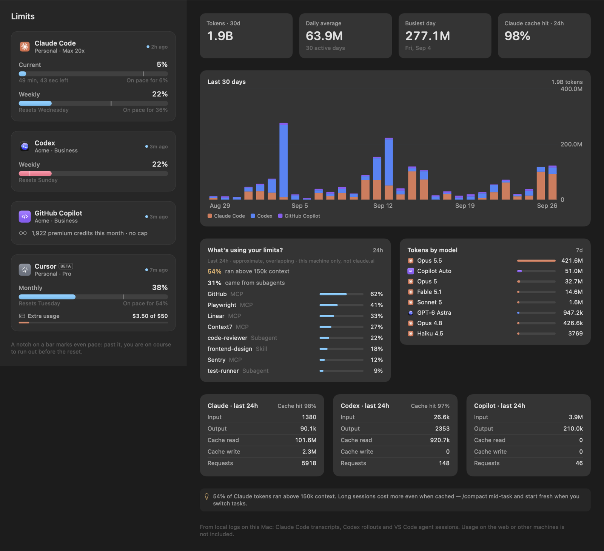

# TokenMeter

[](https://github.com/patrickking67/ai-usage-widgets/actions/workflows/ci.yml)
[](LICENSE)

**Every AI coding plan limit on one meter.** TokenMeter shows how much of your Claude Code, Codex, GitHub Copilot and Cursor plans you have left, whether you're on pace to run out before the reset, and what's actually spending your tokens.



- **Pace, not just percent.** Every bar has a notch where even use would put you. Past it, the bar turns amber, and a flame appears when you're projected to run out before the reset.
- **Where the tokens went.** 30 days of per-vendor tokens from local logs, the input/output/cache breakdown, and the MCP servers, skills and subagents that were running while your limit dropped.
- **Everywhere you look.** A menu bar app, a dashboard window and desktop widgets on macOS. A tray app and desktop widget on Windows. A plugin and a clickable status line inside Claude Code.
- **Reads, never writes.** It borrows the sign-ins your tools already have, never refreshes or stores a token, and has no server or telemetry.
- **VoiceOver.** Each meter, ring and the menu bar label read as one sentence: percent used, when it resets and the pace.

There is no hosted site. [`docs/index.html`](docs/index.html) is a static page you can preview locally (see [Preview the page](#preview-the-page)).

## Lanes

| Lane | Limits | Activity |
| --- | --- | --- |
| Claude | Status line feed plus Anthropic's usage endpoint, using Claude Code's own sign-in. Covers the 5-hour, weekly and per-model windows and extra spend. | `~/.claude/projects` transcripts |
| Codex | Codex's own usage endpoint with Codex's sign-in, falling back to the `rate_limits` Codex records after every turn | Codex session rollouts |
| GitHub Copilot | Premium-request allowance via `gh api /copilot_internal/user`. Uncapped seats show credits used. | VS Code agent-mode chat sessions |
| Cursor (beta) | Monthly usage pool and on-demand spend, using Cursor's local sign-in | None |
| Grok (beta) | The SuperGrok credit pool from the `grok` CLI's billing endpoint | None |
| Microsoft 365 Copilot | No lane: Microsoft exposes Copilot usage only to tenant admins, with no per-person limit to show. | None |

Beta lanes follow the vendors' own clients but haven't been checked against a real account, so their cards say so. The Windows client covers Claude, Codex (rollouts only) and Copilot. Field-level detail is in [`spec/board.md`](spec/board.md) and [`spec/providers.md`](spec/providers.md).

## Data sources and privacy

Every credential read is read-only. TokenMeter never refreshes, rotates, stores, logs or writes back a token: refreshing from a second process would rotate the grant and sign your real tools out, so an expired token is skipped until the vendor's own tool renews it. Each token goes into one request header to that vendor's own endpoint and nowhere else.

| Lane | Reads (macOS) | Sends to |
| --- | --- | --- |
| Claude | `~/.claude.json` (`oauthAccount`: plan and org name, no secrets). The status line feed `~/.cache/tokenmeter/usage.json`. The access token from the Keychain item `Claude Code-credentials`, via `/usr/bin/security find-generic-password -w`, the same tool Claude Code uses, so there is no Keychain prompt. | `api.anthropic.com/api/oauth/usage` and `/api/oauth/profile`, bearer token. Turn off with Settings > Advanced > "Read Claude limits directly". |
| Codex | `~/.codex/auth.json`: the `id_token` is decoded locally for the plan; the `access_token` and `account_id` go in the request. Rollouts under `~/.codex/sessions`. | `chatgpt.com/backend-api/wham/usage`, bearer token |
| GitHub Copilot | Nothing. TokenMeter runs `gh api /copilot_internal/user`, so the GitHub token stays inside `gh`. | `api.github.com`, made by `gh` |
| Cursor (beta) | `cursorAuth/accessToken` from Cursor's `state.vscdb`, opened with SQLite read-only. | `cursor.com/api/usage-summary`, as the session cookie Cursor's dashboard uses |
| Grok (beta) | The sign-in entry in `~/.grok/auth.json` (or `$GROK_HOME`), never a plain API key. | `cli-chat-proxy.grok.com/v1/billing` and `/v1/settings`, bearer token |

On Windows the Claude token comes from `%USERPROFILE%\.claude\.credentials.json`, Codex is read from rollouts only, and Copilot goes through `gh` the same way.

What TokenMeter writes: the board (`~/.cache/tokenmeter/board.json`, or `%LOCALAPPDATA%\TokenMeter\board.json`), its own settings, an activity cache and, on Windows, `tokenmeter.log` next to the board. Logs carry status codes and short error text, never a token. The macOS widget is sandboxed with read-only access to `~/.cache/tokenmeter/` and never sees a credential. Activity charts come from files on this machine only. There is no TokenMeter server, account or telemetry. See [`SECURITY.md`](SECURITY.md) to report a problem.

## Install

### macOS 14+

```bash
brew install xcodegen
git clone https://github.com/patrickking67/ai-usage-widgets
cd ai-usage-widgets/apps/macos
echo 'DEVELOPMENT_TEAM = YOURTEAMID' > Config/Local.xcconfig   # needed for the widgets
xcodegen generate
xcodebuild -project TokenMeter.xcodeproj -scheme TokenMeter -configuration Release -derivedDataPath build build
ditto build/Build/Products/Release/TokenMeter.app /Applications/TokenMeter.app
open /Applications/TokenMeter.app
```

Without `Local.xcconfig` the app builds ad-hoc signed: the menu bar app and dashboard run, but macOS only loads widgets signed with a real team. Then add the **Rings**, **Limits** and **Activity** widgets from the desktop's Edit Widgets menu. Open the dashboard from the popover's **Dashboard** button, with `open tokenmeter://dashboard`, or by Cmd-clicking **Dashboard** in the Claude Code status line.

### Windows 10 / 11

See [`apps/windows/README.md`](apps/windows/README.md). It's a PowerShell and WPF tray app with a desktop widget, and it writes the same board to `%LOCALAPPDATA%\TokenMeter\board.json`.

### Claude Code plugin

```
/plugin marketplace add patrickking67/ai-usage-widgets
/plugin install tokenmeter@tokenmeter
```

| | |
| --- | --- |
| `/tokenmeter:usage` | Limits, pace and the hottest window, with a verdict |
| `/tokenmeter:report` | Weekly report: vendors, models, drivers, week over week |
| `limit-aware-planning` skill | Before a big fan-out, checks headroom and sizes the plan to fit |
| `optimize-usage` skill | Concrete habits to stretch a limit, from your own data |
| Session-start hook | Speaks up only when a Claude window is tight |

### Claude Code status line

[`extras/claude-statusline.sh`](extras/claude-statusline.sh) is a two-row status line:

```
Opus 5.5 · High   ▸ my-app  ⎇ main +2 ~1   ◑ 41% ctx   +120 −30   $4.21 · 1h12m
✳ Acme · Team  5h ━━━╸──── 37% 4h13m  wk ━━╸───── 38% Tue   ◎ Codex wk 30%   ⌬ Copilot 1.9k cr   ↗ Dashboard
```

Cmd-click the folder, the branch, any vendor or **Dashboard**. It also feeds TokenMeter the freshest Claude limits on every turn. To install it:

```bash
cp extras/claude-statusline.sh ~/.claude/statusline.sh && chmod +x ~/.claude/statusline.sh
```

Then set `"statusLine": {"type": "command", "command": "~/.claude/statusline.sh", "refreshInterval": 10}` in `~/.claude/settings.json`. It needs `jq`.

## How it fits together

```
 vendor sign-ins & local logs ──▶  TokenMeter (macOS / Windows)  ──▶  board.json  ──▶  widgets
                                        ▲                                  │
       Claude Code status line ─────────┘ (usage.json)                     ├──▶  Claude Code plugin
                                                                           └──▶  status line row 2
```

Everything reads one documented file, [`board.json`](spec/board.md): `~/.cache/tokenmeter/board.json` on macOS, `%LOCALAPPDATA%\TokenMeter\board.json` on Windows, or `$TOKENMETER_BOARD`. Readers skip vendors they don't know, so a new lane never breaks an older client.

```
apps/macos      SwiftUI menu bar app, dashboard, settings, WidgetKit extension, unit tests
apps/windows    PowerShell + WPF tray app and desktop widget, core tests
plugin/         Claude Code plugin: board.py, skills, commands, hook
extras/         Claude Code status line
spec/           board.json contract, provider research, fixtures
docs/           Static product page (not published)
scripts/        check.sh, the one check command
```

## Tests

One command runs everything CI runs:

```bash
brew install xcodegen shellcheck actionlint powershell   # once
scripts/check.sh
```

It runs shellcheck, actionlint, JSON and PowerShell syntax checks, the plugin tests, the Windows core tests, the macOS unit tests (provider parsing against `spec/fixtures`, pace math, VoiceOver text) and an unsigned Release build. `CHECK_SKIP_XCODE=1 scripts/check.sh` skips the Xcode steps. No test reads a real credential or makes a network request.

## Preview the page

```bash
python3 -m http.server 4116 --bind 127.0.0.1 --directory docs
```

Then open <http://127.0.0.1:4116/>. The same server is configured in `.claude/launch.json`.

## Deploy

Nothing deploys automatically. CI builds and tests on every push and pull request. The macOS and Windows apps are built from source. Plugin users install from `main` with `/plugin marketplace add`, so a merge to `main` reaches them on their next plugin update.

## License

MIT. Not affiliated with Anthropic, OpenAI, GitHub, Microsoft, Anysphere or xAI.
